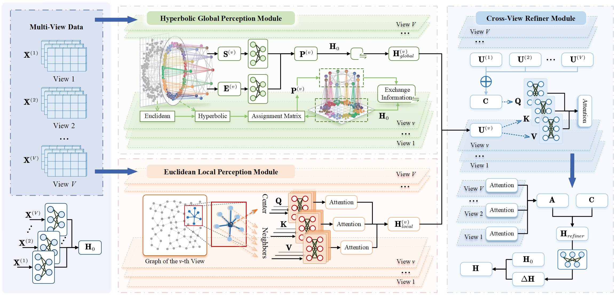

<h1 align="center">ECHO: Euclidean-Hyperbolic Correlational Network for Cross-Scale Multi-View Learning</h1>

## Abstract
Learning discriminative representations from multi-view data remains challenging because different views exhibit heterogeneous structural patterns across scales. Many existing approaches model local and global relations in a single geometric space, which may limit their ability to jointly characterize fine-grained neighborhoods and non-uniform global organization. To address this limitation, we propose the Euclidean-hyperbolic correlational network, termed ECHO, a cross-scale collaborative learning framework. ECHO comprises a Poincar\'e-informed global perception module that performs non-local structural routing through a compact set of supernodes and a Euclidean local perception module for neighborhood aggregation. Within each view, a learnable scalar gate balances neighborhood information from the Euclidean branch with non-local structural context from the Poincar\'e-informed branch. Consensus-guided attention subsequently refines the resulting view-specific representations, with the mean representation across views serving as a consensus query to selectively integrate complementary information while preserving view-specific contributions. Across eight benchmark datasets, ECHO outperforms the compared methods in semi-supervised node classification in terms of both classification accuracy and Macro-F1. Qualitative analyses suggest that the learned representations exhibit more compact intra-class structure and clearer inter-class separation, supporting ECHO as an effective approach to semi-supervised multi-view node classification.

## ECHO Framework
For each view, the Euclidean local and Poincar\'e-informed global paths capture neighborhood and non-local structural information, respectively. Their outputs are adaptively fused within each view and subsequently refined across views through consensus-guided attention.

<p align="center">
  
</p>

## Experiment
The datasets used can be downloaded from [here](https://drive.google.com/drive/folders/1tM-IHlxvvvmvTCa2xxI2XoGc0T5LJ19b?usp=drive_link), please download them and put them in datasets to `data`.
| Dataset | #Samples | # Views | # Feature Dimensions | # Classes |
|:---:|:---:|:---:|:---:|:---:|
|20Newsgroups |  500   | 3 | 2,000/2,000/2,000            |  5 |
|ESP-Game     | 11,032 | 2 | 100/100                      |  7 |
|Hdigit       | 10,000 | 2 | 784/256                      | 10 |
|NUSWIDE      | 1,600  | 6 | 64/144/73/128/225/500        |  8 |
|NUSWIDE20k   | 20,000 | 2 | 100/100                      |  8 |
|OutdoorScene | 2,688  | 4 | 512/432/256/48               |  8 |
|Prokaryotic  | 551    | 3 | 438/3/393                    |  4 |
|UCI          | 2,000  | 3 | 240/76/6                     | 10 |

```bash
pip install -r requirements.txt  
```

Run one dataset
```bash
python main.py --dataset 20newsgroups --device cuda:0
```

Run all eight datasets sequentially
```bash
python main.py --dataset all --device cuda:0
```

## Reference

If you find this work useful in your research, please consider citing:

```bibtex
@inproceedings{zhao2026echo,
author = {Zhao, Wendi and Du, Shide and Xu, Zhiyong and Wu, Yilin and Lin, Weihong and Shi, Yiqing and Wang, Shiping},
title = {ECHO: Euclidean-Hyperbolic Correlational Network for Cross-Scale Multi-View Learning},
year = {2026},
pages = {15397–15406},
doi = {10.1145/3767308.3836477},
}
```
